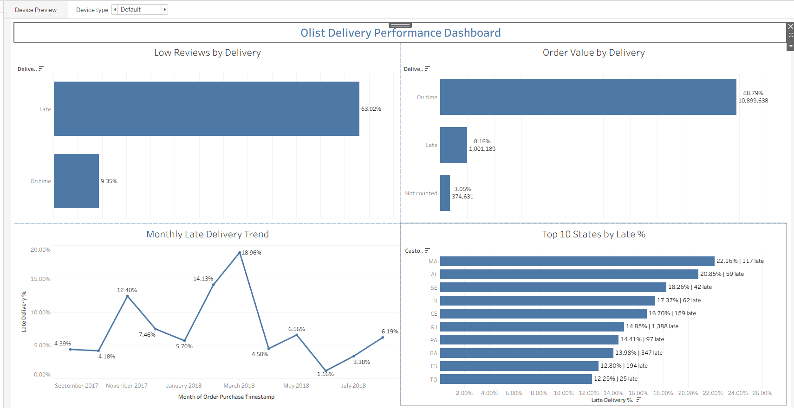
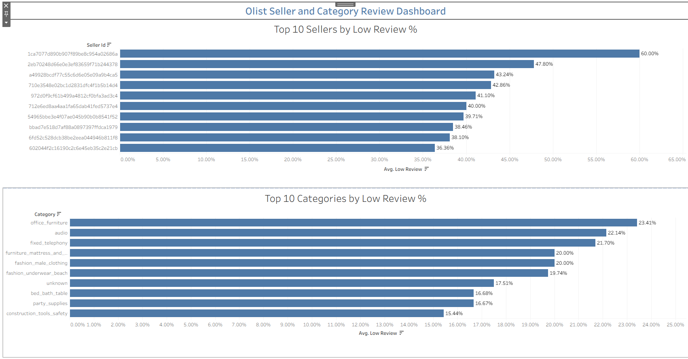

# Olist Delivery Performance Analysis

**Question:** Is late delivery linked to bad reviews, and where should Olist act first?

**Answer:** Yes, strongly linked. **63.02%** of reviewed late orders got 1 or 2 stars, compared with **9.35%** of on-time orders.

## Dashboards

## Scope and tools

- **Data:** Brazilian E-Commerce Public Dataset by Olist (Kaggle)
- **Period:** orders purchased from September 2017 to August 2018 (76,124 orders)
- **MySQL:** table key checks, row counts and extraction of order items
- **pandas:** loading the other tables from source CSV files, quality checks, cleaning, joins and analysis
- **Tableau:** two dashboards

## KPI definitions

| KPI | Definition |
|---|---|
| Late delivery rate | Delivered after the estimated date (dates only) ÷ delivered orders with a delivery date |
| Low review rate | Orders rated 1 or 2 stars ÷ reviewed orders |
| Cancellation rate | Cancelled orders ÷ all orders in the period |
| Order value | Sum of recorded payments (not profit) |

## Key findings

| Area | Finding |
|---|---|
| Delivery | 5,762 orders were late (7.76% of counted deliveries) |
| Reviews | Low review rate was about 6.7 times higher for late orders |
| Order value | Late orders held R$1.00 million of R$12.28 million (8.16%) |
| Handover | Of 5,761 late orders checked, sellers handed over on time in 72.61% |
| Trend | Late rate peaked in March 2018 (18.96%). November 2017, February 2018 and March 2018 held about 55% of late orders |
| States | MA had the highest late rate (22.16%). SP had the most late orders (1,546). RJ combined high volume (1,388) with a high rate (14.85%) |
| Sellers | Among sellers with 30+ delivered single-seller orders, the highest low review rate was 60.00% |
| Categories | office_furniture had the highest low review rate (23.41%). bed_bath_table had about 1,136 low reviews |
| Repeat orders | 1.13% of late-delivery first-time customers ordered again, compared with 1.54% for on-time |
| Cancellations | 409 orders (0.54%). 82.89% had no carrier or delivery date |

## Recommendations

1. **Review delivery after seller handover, starting with RJ.** Work with the logistics team and carriers on slow routes.
2. **Plan capacity before busy or high-delay months.** Check November and February to March against more years of data.
3. **Follow up with high-risk sellers.** Coach those who miss shipping deadlines. For those who ship on time, check product quality and descriptions.
4. **Investigate weak categories.** Start with office_furniture (highest rate) and bed_bath_table (high volume).
5. **Test early delay messages.** Tell some affected customers about delays and compare their review scores with others.

**Track monthly:** late delivery rate, low review rate and late seller handovers.

## Data quality notes

| Issue | Action |
|---|---|
| Dates stored as text | Converted to datetime |
| Missing order dates | Left empty |
| 8 delivered orders without a delivery date (full dataset) | Excluded from the late delivery KPI |
| Several items or payments per order | Grouped or filtered before order-level joins |
| Several reviews for some orders | Kept the latest answered review |
| 610 products without a category | Labelled `unknown` |

## Limitations

- The results show links, not proof of cause.
- There is no cancellation reason, cancellation date or returns data.
- Order value linked to late orders is not proven lost revenue.
- Seller results use single-seller orders. Category results use single-category orders.
- Customers who ordered later in the period had less time to order again.
- The data is historical and may not reflect Olist today.
